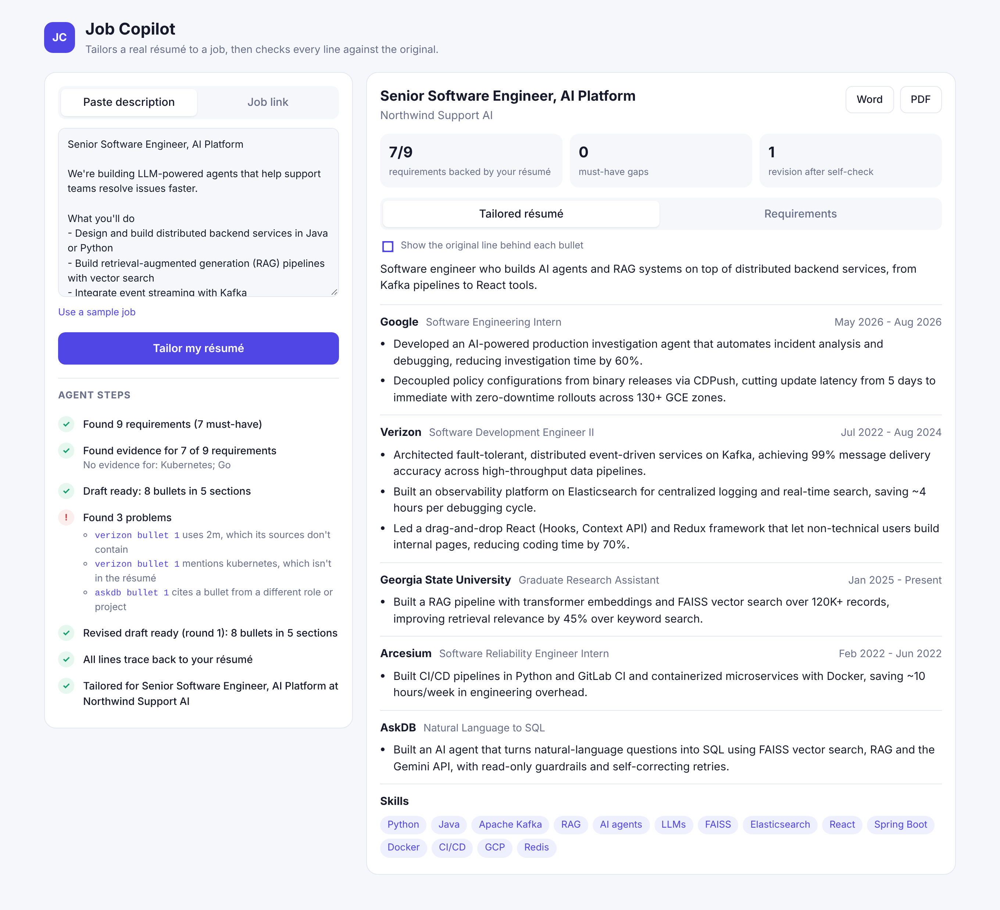

# Job Copilot — Résumé Tailoring Agent

Paste a job description (or a link to one) and an AI agent tailors your résumé to it. It pulls out the job's requirements, finds your strongest evidence for each, rewrites and reorders your bullets, then checks every line against your real résumé before you see it. If the draft invents a number, a technology or a skill, the agent is told exactly what's wrong and revises. You download the result as Word or PDF.




## Features

- **Agent loop with self-correction**: extract requirements → retrieve evidence → draft → check → revise, up to two revision rounds
- **Truth checks in plain code, not a model**: every tailored bullet must cite the résumé bullets it came from (same role only), and may not add numbers, technologies or skills that aren't in those sources
- **Never ships a made-up claim**: if a line still fails after the revisions, it's replaced with your original wording
- **Honest coverage report**: each requirement shows the résumé lines that back it; anything you don't have (say, Go or Kubernetes) is listed as a gap, never claimed
- **Live trace**: the React UI streams each step as it happens, including the problems the checker found
- **Word and PDF export**: titles, dates and companies are copied from your résumé, never generated
- **Job links**: fetches a posting from a URL (public addresses only) or takes pasted text

## How it works

```
job text / URL ─▶ extract requirements (Gemini, JSON)
                          │
                          ▼
            BM25 search over résumé bullets ─▶ evidence per requirement
                          │
                          ▼
         ┌──────▶ draft tailored résumé (Gemini, cites source ids)
         │                │
         │                ▼
         │        truth checks (code): sources real? new numbers?
         │        new technologies? unknown skills? too long?
         │                │
         └── problems ────┤ (max 2 revisions, then fall back to original lines)
                          ▼
              coverage report + DOCX / PDF
```

The résumé is structured JSON where every bullet has an id (`verizon-1`, `gsu-2`…). The model only ever sees and cites those ids, which is what makes each tailored line checkable. The model sits behind a one-method interface, so the whole loop runs offline in tests with a scripted model.

## Run it

```bash
git clone https://github.com/ramya036/job-copilot.git
cd job-copilot

# API
cd backend
python -m venv .venv && source .venv/bin/activate   # Windows: .venv\Scripts\activate
pip install -r requirements.txt
export GEMINI_API_KEY=your_key                      # free at https://aistudio.google.com/apikey
uvicorn copilot.api:app --reload

# UI (second terminal)
cd frontend
npm install
npm run dev
```

Open http://localhost:5173 and click **Use a sample job**. Without `GEMINI_API_KEY` the app runs an offline demo model that picks and orders your bullets but keeps their original wording.

**Docker**

```bash
docker build -t job-copilot .
docker run -p 8000:8000 -e GEMINI_API_KEY=your_key job-copilot
```

**Use your own résumé**: copy `backend/copilot/resume_ramya.json`, keep the same shape (each bullet needs a unique `id`) and set `RESUME_PATH` to your file.

**API**: `POST /api/tailor` with `{ "job_text": "..." }` or `{ "job_url": "https://..." }` streams server-sent events, one per agent step, ending with the full result and a `run_id`. `GET /api/runs/{run_id}/resume.docx` or `.pdf` downloads the tailored résumé.

| Variable | Default | Description |
|---|---|---|
| `GEMINI_API_KEY` | none | Enables tailoring with Gemini; without it the offline demo model is used |
| `GEMINI_MODEL` | `gemini-2.5-flash` | Any Gemini model that supports JSON output |
| `RESUME_PATH` | `backend/copilot/resume_ramya.json` | Your résumé JSON |

## Tests

```bash
cd backend
pip install -r requirements-dev.txt
pytest
```

21 tests cover evidence retrieval, the number and technology checks, citation rules, the revise loop (a draft with invented claims is caught and fixed), the fallback when the model never complies, honest gaps, Word and PDF export, job-page parsing, refusing private URLs, and the streaming API. They use a scripted model, so they need no network or API key. GitHub Actions runs them and builds the UI on every push.

The screenshots were recorded with that scripted model replaying a typical run, because the build machine can't reach the Gemini API.

## Project structure

| File | Description |
|---|---|
| `backend/copilot/agent.py` | The agent loop and its step events |
| `backend/copilot/checks.py` | Truth checks and the safe fallback |
| `backend/copilot/evidence.py` | BM25 evidence search with tech synonyms |
| `backend/copilot/resume.py` | Résumé model with bullet ids |
| `backend/copilot/llm.py` | Gemini client and scripted test model |
| `backend/copilot/demo.py` | Offline demo model for running without a key |
| `backend/copilot/export.py` | Word and PDF rendering |
| `backend/copilot/jobpost.py` | Job-link fetching and HTML to text |
| `backend/copilot/api.py` | FastAPI app with streaming steps and downloads |
| `backend/copilot/resume_ramya.json` | Résumé data |
| `frontend/src/` | React UI: input, live agent trace, tailored résumé, requirements |
| `backend/tests/` | pytest suite |
| `docs/` | Screenshots |
